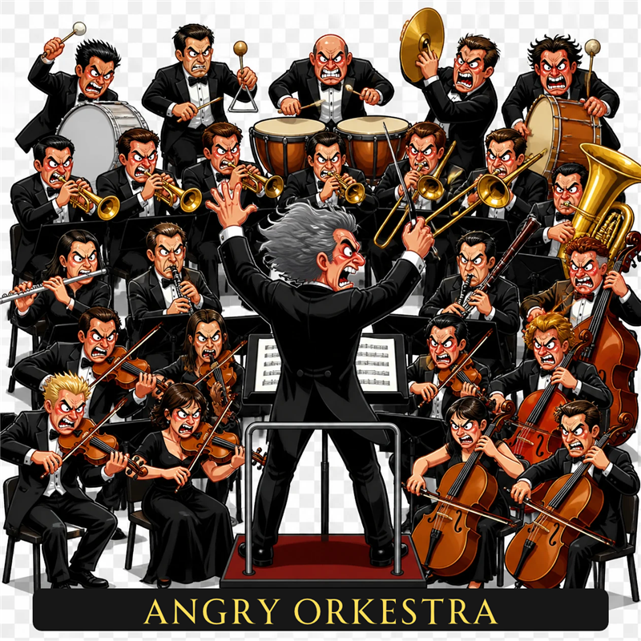

<p align="center">
  
</p>

<h1 align="center">Angry Orkestra</h1>

<p align="center"><b>Memimpin tim AI seperti seorang konduktor memimpin orkestra.</b></p>

> © 2026 [FRCHN](https://github.com/FRCHN) — Licensed under MIT License.

---

## 🎼 Anggap Ini Seperti Orkestra

Bayangkan sebuah orkestra klasik:

- Ada **konduktor** di depan — dia **tidak** memainkan biola atau piano. Tugasnya cuma satu: **mengatur siapa memainkan apa**, dan kapan. Kalau ada pemain yang salah duduk di kursi, dia yang mengurusnya.
- Di belakangnya ada **banyak pemain musik** — masing-masing **jago di satu alat**. Si biolist tidak pindah main piano. Si pemain drum tidak mendadak jadi penyanyi.

**Angry Orkestra** bekerja persis begitu, tapi pemainnya adalah **para asisten AI**:

| Peran | Siapa | Tugasnya |
|---|---|---|
| 🎼 Konduktor | `orchestrator` (si bos) | Menerima tugas dari kamu, menilai apakah tugasnya sudah jelas, lalu **membagikannya ke asisten yang tepat**. Ia tidak mengerjakan pekerjaan teknis sendiri. |
| 🎻 Pemain musik | `flutter-mobile-dev`, `db-admin`, dst. | Masing-masing **spesialis satu bidang**. Asisten mobile hanya mengerjakan aplikasi HP. Asisten database hanya mengurus data. |
| ✍️ Penulis lembaran musik | `skill-author` | Kalau ada jenis pekerjaan baru yang **belum ada panduannya**, ia menuliskan panduan baru dari nol. |

> **Kenapa "angry" (marah)?** Karena konduktor ini **galak** terhadap pekerjaan yang tidak jelas dan tugas yang salah alamat. Lebih baik ia menolak dulu dan bertanya, daripada kerjakan salah. Itu inti sifat "marah"-nya.

---

## 🧩 Masalah yang Diselesaikan

Kamu punya banyak tugas teknis: bikin aplikasi, rapikan data, optimasi kecepatan, dll.

Percuma kalau kamu minta bantuan **satu asisten AI** untuk semuanya — dia jago satu bidang, tapi **bukan ahli di bidang lain**. Hasilnya: pekerjaan yang salah, capek di tempat.

Angry Orkestra memecah masalah itu:

1. **Tugas kamu diterima si bos.**
2. Si bos **menilai dulu**: tugas ini jelas atau belum? Kalau belum jelas, ia **bertanya dulu**, bukan menebak.
3. Si bos **membagikannya ke asisten yang paling ahli** untuk urusan itu.
4. Kalau ternyata asisten tadi bukan ahlinya, ia **dengan sopan menolak** dan mengembalikannya ke si bos — lalu tugas diteruskan ke asisten yang tepat.
5. Semua hasil **digabungkan** dan dilaporkan ke kamu.

**Hasilnya:** tugas teknis kamu dikerjakan oleh tim spesialis yang benar, bukan oleh satu asisten yang dipaksa jago segalanya.

---

## 📚 Dua Kata Penting: "Skill" dan "Agent"

Ini dua istilah yang dipakai di seluruh proyek ini. Mudahnya:

### Agent = si **pemain** musik
Definisi seorang asisten: **apa keahliannya, alat apa yang boleh dipakainya, dan bidang apa yang jadi tanggung jawabnya**. Ada di folder `agents/`.

### Skill = **lembaran musik** (panduan) yang dia pegang
Panduan langkah demi langkah untuk menyelesaikan satu jenis pekerjaan tertentu. Ada di folder `skills/`.

Seorang pemain (agent) bisa memegang **lebih dari satu lembaran musik** (skill). Misalnya asisten database pegang panduan "melindungi bidang" *dan* panduan "mempercepat database".

---

## 🗂️ Struktur Folder (Panduan Lengkap)

```
angry-orkestra/
├── README.md            ← file ini (penjelasan & cara pakai)
├── LICENSE              ← izin penggunaan (MIT)
├── sync.sh              ← "mesin penyalin" ke platform yang dipakai
├── agents/              ← daftar para pemain (definisi tiap asisten AI)
│   ├── orchestrator.md        bos / konduktor
│   ├── skill-author.md        penulis panduan
│   ├── flutter-mobile-dev.md  ahli aplikasi HP
│   └── db-admin.md            ahli data & database
├── skills/              ← daftar lembaran musik (panduan pekerjaan)
│   ├── domain-guard/          panduan: "tolak kalau bukan bidangmu"
│   ├── task-clarity/          panduan: "tolak kalau tugasnya belum jelas"
│   └── database-optimization/ panduan: mempercepat database
└── config/
    └── categories.yaml  ← kamus: "tugas tentang X → serahkan ke Y"
```

---

## 🚀 Cara Pakai (3 Langkah)

### 1. Ubah sesuatu di sini (folder `angry-orkestra/`)
Folder ini adalah **"master"** — sumber kebenaran tunggal.
- Mau menambah/mengubah panduan? → edit file di `skills/`
- Mau menambah/mengubah asisten? → edit file di `agents/`
- Mau mengubah "siapa mengerjakan apa"? → edit `config/categories.yaml`

### 2. Salin ke platform yang kamu pakai
Jalankan satu perintah (butuh Bash — Git Bash/WSL di Windows):
```bash
./sync.sh --opencode   # salin ke OpenCode
./sync.sh --claude     # salin ke Claude
./sync.sh --cursor     # salin ke Cursor
```

### 3. Cek & batalkan kalau ada yang salah
```bash
./sync.sh --status     # bandingkan versi di sini vs di platform
./sync.sh --dry-run    # pratinjau yang akan disalin, TANPA benar-benar menyalin
```

> **Aman:** sebelum menimpa file lama, `sync.sh` otomatis menyimpan cadangan dulu.
> Kalau ada yang salah, tinggal kembalikan dari folder cadangan itu.

---

## 🛡️ Aturan Emas

> **Edit HANYA di sini (folder `angry-orkestra/`).**

Jangan pernah mengedit langsung di folder platform (`~/.config/opencode/`, `~/.claude/`, dll).
Perubahan di sana **akan tertimpa** saat kamu menjalankan `sync.sh` lagi.

Anggap seperti ini: folder ini adalah **dokumen asli**, folder platform hanyalah **fotokopian**. Kalau kamu mengubah fotokopinya, perubahan itu hilang saat difotokopi ulang.

---

## ✨ Fitur Unggulan

| Fitur | Artinya bagi kamu |
|---|---|
| **Menolak tugas yang tidak jelas** | Asisten bertanya dulu, bukan menebak → hasil lebih akurat, tidak buang waktu. |
| **Menolak tugas di luar bidangnya** | Pekerjaanmu selalu ditangani ahlinya, bukan dipaksakan ke asisten yang salah. |
| **Membuat panduan baru otomatis** | Ada jenis pekerjaan baru? Asisten bisa menuliskan panduannya sendiri (skill), tanpa kamu perlu menulis manual. |
| **Kerja paralel** | Tugas besar dipecah jadi bagian-bagian dan dikerjakan **bersamaan** → lebih cepat selesai. |
| **Non-destruktif** | Menyalin ke platform **tidak menghapus** asisten/panduan lain yang sudah ada di sana. |

---

## ⚠️ Batasan (jujur)

- **Cursor**: asisten tidak didukung penuh (hanya "rules"); sebagian skill — verifikasi dulu sebelum dipakai.
- **Windows**: `sync.sh` butuh Bash (Git Bash atau WSL).
- **Format** sedikit beda antar platform → cek saat menyalin ke platform baru untuk pertama kali.

---

## 📄 Lisensi

Proyek ini dirilis di bawah **MIT License** — bebas dipakai, diubah, dan dibagikan.
Lihat `LICENSE` untuk detail.
